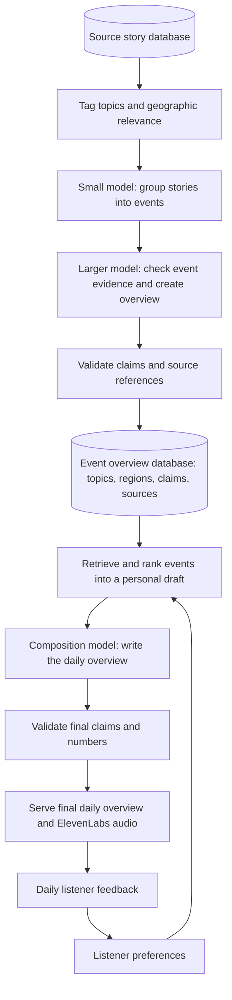

# VoxNews build plan

Build a personalized daily overview from reusable event overviews, then deliver it as text and audio. Categorize source stories, group coverage of the same event with a small model, and use a larger model to check the evidence and create an event overview before personalizing the result for listeners.

The [local pipeline](README.md) connects source import, classification, event grouping, checked event dossiers, listener drafts, daily text and feedback through SQLite stores. The text backend has passed automated regression checks and live local-model delivery checks. ElevenLabs verification is deferred at the user's request. Requirements come from [the challenge brief](Sourcera-Track-Description.md), [project instructions](AGENTS.md), and [dataset notes](liquid-briefing-data/README.txt).

## Pipeline and terminology

A **story** is one source article. An **event** is a specific occurrence covered by one or more stories, possibly across publishers and languages. A **category** is a topic such as technology or currencies. Categories organize coverage; events connect stories about the same occurrence.

The source and event databases are logical stores and may share one database instance for the MVP. Event checking and overview generation happen once per event revision and are reused across listeners. The composition model receives the selected event overviews and their evidence references; it preserves their facts, attribution, and uncertainty.

The shared event overview must remain broad enough for different listeners. Retain the main development, background, mechanisms, key figures, chronology, affected people and places, reactions, reported implications, outlook and uncertainty where source material supports them. Index the full source material and check passages beyond the lead. Store approved detail and the coverage gaps by facet. The overview editor must retain every approved claim. Apply listener-specific length and depth limits when building the personal draft. Missing or held evidence stays visible in the internal record and cannot supply invented context.

| Stored record | Minimum information and links |
|---|---|
| Source story | Original article ID, publisher, permalink, source language, publication time, source text, topic categories, geographic tags, and duplicate/reporting-origin links |
| Event and membership | Stable event ID, event description and time, topic categories, countries materially involved or affected, linked story IDs, grouping status and revision |
| Event overview revision | Event ID, overview, geographic scope and supporting story IDs, claim IDs and evidence states, supporting/contradicting source references, input story versions, model/prompt versions, and processing status |
| Listener profile | Preferred topics, briefing language, optional local news region, target duration, depth, profile version, and adjustment history |
| Personal draft | Listener and profile version, briefing date/cutoff, ordered event overview revision IDs, selected claim IDs, inclusion reasons, and length/depth budget |
| Final daily overview | Draft ID, text segments linked to event revisions and claim IDs, validation result, and audio references |
| Daily feedback | Listener, daily overview ID, answers, and resulting profile adjustment |

Only validated event overview revisions enter the listener retrieval pool. A processing failure leaves the event pending or failed, and an evidence check is not a guarantee of truth. Preserve immutable revisions so an older briefing can still be audited after coverage changes.

## How to use this backlog

- Work through the dependencies shown on each task. Check a task off only when its completion condition is met.
- **P0:** required for the complete MVP, including preferences, daily feedback, and evidence tracking.
- **P1:** evaluation and delivery tasks required before presenting the prototype.
- **P2:** product work after the MVP.
- Save evaluation results and known limitations alongside the implementation. A checked task means its behavior has been demonstrated, not just that code exists.

### Backend verification on November 21

Run `python3 tests/check_backend.py` for the non-audio regression checks. Checked tasks below reflect the demonstrated text backend. Audio acceptance remains deferred. All 61 non-audio regression tests pass. The suite covers source import and revisions, historical cutoffs, classification, grouping, checked dossiers, broad event context, profile setup, immutable text delivery, concurrent composition, daily feedback and listener isolation. Real-dataset two-day text examples and their source audits are under `output/backend-audit/`. The evaluation documents record the scope and limitations of each run.

| Plan area | Current evidence and remaining verification |
| --- | --- |
| F03–F05 | All six feeds imported, repeat imports add no versions, November 17/18 source windows published separately, earlier citations remain resolvable, cleanup documented. |
| C01–C06 | Taxonomy and geographic tests pass. Final grouping matches six positive and five negative pairs in the targeted manual reference. Full-corpus accuracy still needs the official answer key. |
| T01–T06 | Source-linked event records, evidence checks, publication and inspection are connected. Broad extraction preserves checked context across editorial facets. Regression checks cover event-wide conflicts, qualified forecasts and allegations, source independence, and localized numeric values. The final full-feed run checks 40 selected revisions, completes 37, quarantines three and publishes 76 statements across 29 events. Shared overviews retain broad context before personalization. |
| L01–L04 | Structured, versioned settings and personal drafts work in the daily HTTP flow. Tests and dataset replays cover region, language, depth, sparse coverage and date selection. |
| B01–B02 | Three live HTTP profiles passed composition and source auditing. The model selects and orders approved sentences. Rendering supplies localized framing and required uncertainty caveats. Output validation binds wording and lineage to the draft. |
| D01–D04 | Real two-day text replays and HTTP tests cover automatic adjustments, repeated submissions, skip, undo, listener isolation and suppression of delivered facts. |
| B03, audio portions of B04, E02 and E04 | ElevenLabs verification and listening review are deferred at the user's request. Text evidence and delivery checks run independently. |
| E01, E03, E05–E06 | Manual references, custom listener comparisons, stage cost reporting and a documented demo sequence are available. Local-model runs record stage usage and bounded coverage. Organizer references, hosted-provider validation and speech measurements remain outstanding. |
| P01–P05 | Product work after the MVP. Customer validation, production operations and content rights require separate pilot work. |

## MVP: source database and foundation

- [ ] **F01 · P0 · Establish the runnable application.** Choose and document the application stack, database, and providers for the small grouping model, larger event-checking model, and daily composition model. Use ElevenLabs for speech generation. Configure these roles independently; record selected models and prompts, plus the ElevenLabs voice and speech model. **Done when:** a teammate can start the application from documented setup steps without committing credentials.

- [ ] **F02 · P0 · Implement the storage records and stage contracts.** Create the linked records defined above with stable IDs, revision identifiers, and structured model outputs. Preserve `source story → event → overview revision/claim → personal draft → final segment → audio segment`, plus the listener profile version. **Depends on:** F01. **Done when:** example records can be stored and loaded, and invalid references or malformed stage outputs are rejected.

- [x] **F03 · P0 · Import stories into the source database.** Load all six JSONL feeds; preserve article IDs, source permalinks, publication, language, dates, and source text for internal processing. Report invalid records and missing fields; make reimports safe without duplicating records or losing changed source versions. **Depends on:** F02. **Done when:** an import report accounts for every input record and repeating an unchanged import adds no duplicates or unnecessary model work.

- [x] **F04 · P0 · Define the briefing's date window.** Use an explicit briefing date and configurable lookback period; treat older articles as dated context. Account for the much longer Zacks date range. Apply the cutoff to source stories and the inputs of event overview revisions. **Depends on:** F03. **Done when:** a historical run cannot retrieve an overview containing later reporting and labels older context correctly.

- [x] **F05 · P0 · Respect the dataset's usage terms.** Keep full article text in internal processing; expose source links and permitted short excerpts in the demo. Document deletion of dataset copies and derived artifacts containing licensed text after the event. **Depends on:** F03. **Done when:** the demo does not republish article bodies and the cleanup procedure identifies stored copies and outputs.

## MVP: story categories and event grouping with a small model

- [x] **C01 · P0 · Define a shared topic taxonomy.** Start with economy and central banks, companies and stocks, currencies, crypto, technology and AI, politics and world, and other news. Allow multiple topics per article, with separate language, geography, and entity fields. **Depends on:** F02. **Done when:** each topic has a description and representative labeled examples.

- [x] **C02 · P0 · Categorize each source story.** Map publisher categories into the taxonomy, then use article text and an inexpensive classifier where tags are missing or ambiguous. Persist categories, method, and uncertainty on each story before event grouping. Do not use the supplied POSITIVE/NEGATIVE tags as trust signals. **Depends on:** F03, C01. **Done when:** a reviewed sample across all feeds and languages has recorded errors and corrections, and uncertain classifications remain identifiable.

- [x] **C06 · P0 · Tag stories for local news.** Keep the original article language and assign geographic tags from the places materially involved in or affected by the reported event. Start with country codes such as `NL` and `DE`, plus `global` for worldwide scope and `unknown` for insufficient evidence. Use publisher location tags as hints and confirm them against the headline and excerpt or a short passage. Reuse the small classifier for ambiguous cases and keep the evidence reference behind each regional match. **Depends on:** C02. **Done when:** articles about the same international event get consistent geographic tags across translations, and English reporting about the Netherlands or Germany can qualify for the corresponding local feed.

- [x] **C03 · P0 · Merge duplicate and translated coverage.** Detect exact copies and near duplicates, including English, German, and Dutch versions of the same Invezz article. Retain every source link and identify shared reporting origins. **Depends on:** C02. **Done when:** translations and copies count as one reporting origin when assessing corroboration.

- [x] **C04 · P0 · Assign stories to events with the small model.** Find candidate events using categories, time, entities, and semantic similarity, then ask the small model to match a story to an existing event or create one. Consider candidates across related categories and languages. Save membership, grouping uncertainty, stable event IDs, and categories; a later article about the same occurrence updates its event. **Depends on:** F04, C03, C06. **Done when:** reviewed examples merge coverage across publishers and languages, keep separate occurrences involving the same company distinct, and defer ambiguous assignments for review before event checking.

- [x] **C05 · P0 · Rank eligible events for editorial importance.** Rank published event overview revisions using recency, event significance, and breadth of impact before applying listener preferences. Prevent duplicate volume or the size of the Zacks feed from dominating the ranking. **Depends on:** T06. **Done when:** each selected event has an inspectable ranking explanation and repeated coverage does not create repeated briefing items.

## MVP: event checking and overview creation with a larger model

The larger model receives the event's source stories, reporting-origin links, and any relevant available official releases. It extracts and checks claims and returns a structured event overview with citations, disagreements, and limitations. Trust ratings describe the evidence supporting individual claims; store evidence states and reasons rather than an unexplained numerical trust score. Model agreement with supplied reporting does not establish external verification.

- [x] **T01 · P0 · Build the larger model's event-checking stage.** Pass the event's source material and request structured claims, an overview, evidence references, and disagreements. Extract figures, units, currencies, dates, attribution, and whether statements are reporting, allegations, forecasts, or analysis. Attach claims to story IDs, permalinks, and internal supporting passages or offsets. **Depends on:** F02, C04. **Done when:** the event result follows the storage contract and a reviewer can locate exact source support for its claims.

- [x] **T02 · P0 · Assign explainable evidence states.** Use `supported` for a claim supported by one reporting origin, `corroborated` for agreement across independent origins, `disputed` for conflicting evidence, and `unsupported` when no adequate source support exists. Record supporting and contradicting evidence and a reason; conflict takes precedence over agreement. **Depends on:** C03, T01. **Done when:** examples exercise all four states and copied or translated reports cannot inflate corroboration.

- [x] **T03 · P0 · Validate the event model's evidence and figures.** Check that cited sources belong to the event and supporting passages exist; compare values, dates, units, and context with those passages and relevant official releases when available. Distinguish revisions, reporting periods, estimates, and actual results. **Depends on:** T01. **Done when:** fabricated citations and mismatched figures are rejected, and the result records which claims were checked against official releases and which were only checked against reporting.

- [x] **T04 · P0 · Finalize a broad evidence-backed event overview.** Validate the larger model's overview against the checked claims; exclude unsupported statements and preserve disagreements with explicit attribution. Preserve the supported development, background, mechanisms, figures, timeline, affected groups, reactions, implications and uncertainty across the full event. Save claim links, facet coverage and limitations so later listener-specific selection can change the angle and depth. **Depends on:** T02, T03. **Done when:** every factual overview statement maps to eligible claims, conflicting figures receive explicit treatment, and headlines and detailed drafts reuse the same rich overview revision without repeating shared event checks.

- [x] **T05 · P0 · Provide an event and claim inspection view.** Show each event's categories, overview revisions, source stories, claim evidence states, explanations, and disagreements, accessible from the final text or audio segment. **Depends on:** T06. **Done when:** a reviewer can trace three selected spoken claims through their event overviews to supporting articles without searching the dataset manually.

- [x] **T06 · P0 · Publish and reuse event overviews in the database.** Store each validated overview revision under its event ID with topic categories, geographic scope, source links, claims, and processing metadata. Publish a country tag only when the event evidence shows material involvement or impact there. Publish only after validation; retain failed results separately. New or corrected coverage, changed membership, or model/prompt changes require a new checked revision before serving the changed information. Reuse unchanged results across listeners and runs. **Depends on:** T04. **Done when:** retrieval can filter validated revisions by region, unchanged events do not trigger repeated large-model calls, and new coverage creates a validated revision while prior briefings retain their original references.

## MVP: listener preferences and personalization

- [x] **L01 · P0 · Build structured listener setup.** Collect topics to hear more or less about, briefing language, an optional country for local news, target duration, and desired depth. Suggest the Netherlands for Dutch and Germany for German, with a separate control to confirm, change, or skip the suggestion. Use general coverage when the listener skips the region. **Depends on:** C01, F02. **Done when:** a listener can save a profile such as English narration with Netherlands coverage, or Dutch narration with general coverage.

- [x] **L02 · P0 · Save editable, versioned profiles.** Persist each listener's choices with timestamps and distinguish explicit settings from changes learned through feedback. **Depends on:** L01. **Done when:** reloading retains preferences and each briefing can identify the exact profile version used.

- [x] **L03 · P0 · Retrieve event overviews into a personal draft.** Query the event database for the latest eligible validated revision per event using only reporting available by the briefing cutoff. Rank by editorial importance and topic preferences, and prioritize verified geographic matches in a local section when a region is selected. Use eligible evidence in any source language and compose the briefing in the chosen listening language. Present other stories as general coverage, and tell the listener when there are no eligible updates for their region. Save event revision IDs, selected claims, inclusion reasons, and the profile version. **Depends on:** C05, L02. **Done when:** switching regions can change story selection while the listening language stays the same, and both drafts reuse saved event overviews.

- [x] **L04 · P0 · Handle sparse coverage in the draft.** Set a shorter target when there is insufficient relevant, supported news and explain the coverage limitation. If there are no eligible events, return a clear no-news result without calling the composition or speech model. **Depends on:** L03. **Done when:** unusual preferences and a day without eligible events produce honest results without invented filler or unnecessary model calls.

## MVP: daily composition model and final delivery

- [x] **B01 · P0 · Compose the daily overview from the saved draft.** Give the separate composition model the draft's selected event overviews, eligible claims, source references, required caveats, and listener settings. Generate an introduction, ordered event segments, transitions, and closing in the requested language and depth. Preserve claim and event revision links; distinguish forecasts and analysis and avoid investment recommendations. **Depends on:** L03, L04. **Done when:** the model returns a coherent personal daily overview using only supplied evidence, and two listener outputs differ beyond their voice.

- [x] **B02 · P0 · Validate and save the final daily overview.** Check the composition model's text against the draft's event revisions and claim evidence, including numbers, translation, attribution, and disagreements. Save the final overview, lineage, and validation result; block delivery and narration on failure. **Depends on:** B01, T03, T04. **Done when:** an invented claim, changed figure, or omitted material caveat prevents publication, while valid text can be served with its source links.

- [ ] **B03 · P0 · Narrate the final daily overview with ElevenLabs.** Send the exact validated text to ElevenLabs Text to Speech from the backend and save MP3 audio for the introduction, event segments, and closing. Include the spoken synthetic-voice disclosure in the validated introduction. Store voice/model settings and link audio segments to final text, event revisions, and claims. Cache completed segments by text and generation settings so playback and unchanged reruns reuse audio. **Depends on:** B02. **Done when:** playable audio matches the validated overview, has a measured duration, and retains provenance; failed segments can be retried without regenerating successful ones, and an audio failure leaves the validated text available with an accurate status.

- [ ] **B04 · P0 · Serve the final daily overview.** Provide the final text, audio playback, event navigation, evidence and source links, and profile editing. Show the briefing date and synthetic narration disclosure; distinguish processing, ready text, ready audio, and failed states. **Depends on:** B03, T05, L02. **Done when:** a listener can complete setup, read or hear the final daily overview, and inspect a claim in one application flow.

### ElevenLabs integration defaults

- Keep `ELEVENLABS_API_KEY` on the backend in an untracked environment file or managed secret. Configure `ELEVENLABS_VOICE_ID` and `ELEVENLABS_MODEL_ID` at setup; use one configured narrator for the demo and confirm its quality in the supported demo languages.
- Use the [Text to Speech conversion endpoint](https://elevenlabs.io/docs/api-reference/text-to-speech/convert) with `output_format=mp3_44100_128`. Follow the [official setup guide](https://elevenlabs.io/docs/eleven-api/quickstart) for authentication and SDK setup.
- Play saved segments in order with their corresponding transcript and source links. Keep successful demo audio available locally for rehearsal and presentation; changing only the audio settings must not rerun event processing or composition.
- Record narration text characters, request latency, retries, audio duration, and available provider usage data. Calculate speech cost separately using the actual ElevenLabs plan and model, rather than treating narration as LLM text-token usage.

## MVP: daily feedback and adjustment

- [x] **D01 · P0 · Add a quick daily check-in.** Ask whether the briefing was useful, whether its length and depth fit, and which topics should receive more or less coverage. Add the check-in to the briefing screen after listening or on return, allow skipping, and associate answers with that listener's briefing. **Depends on:** B04. **Done when:** a listener can submit a short check-in or skip it without blocking playback.

- [x] **D02 · P0 · Apply feedback to the next briefing.** Update topic weights, duration, and depth automatically when the answers request those changes. Apply explicit choices directly, bound relative adjustments to supported settings, and do not infer topic preferences from a usefulness rating alone. Missing feedback leaves the profile unchanged. **Depends on:** D01, L02. **Done when:** a saved check-in changes the next briefing's relevant selection or delivery while leaving evidence requirements intact.

- [x] **D03 · P0 · Make adjustments visible and reversible.** Show a brief explanation such as “More technology stories and a shorter briefing tomorrow,” save the feedback and profile change history, and allow the listener to edit or undo the adjustment. Avoid applying a submitted response twice. **Depends on:** D02. **Done when:** the listener can inspect and reverse a change and a repeated submission does not compound it.

- [x] **D04 · P0 · Demonstrate the daily cycle.** Run consecutive historical briefing dates, retain delivered event revision history, and distinguish new events or material updates from previously covered events. Reuse the event database while changing the listener's draft and final overview in response to feedback. **Depends on:** F04, B04, D03. **Done when:** day one's feedback visibly affects day two, unchanged events are not presented as new, and feedback does not trigger repeated shared event checks.

## MVP: evaluation, cost, and presentation

- [ ] **E01 · P1 · Evaluate story-to-event processing and overview quality.** Obtain the supplied answer key and compare categorization, small-model event grouping, duplicate handling, event ranking, extracted facts, and larger-model overviews against it. Include translations, copied reporting, separate events involving one company, disputed figures, and a new article updating an event. Use a clearly labeled manual reference sample until the official key is available. **Depends on:** C05, T06. **Done when:** results and representative failures are recorded; manual review is not presented as an official answer-key result.

- [ ] **E02 · P1 · Audit claims through the complete pipeline.** Check at least three claims from actual audio against their source articles, including a numeric claim. Trace each through the final overview, personal draft, event overview revision, and original evidence. Check that composition preserves caveats and historical cutoffs exclude future reporting. **Depends on:** B04. **Done when:** the audit records spoken wording, source support, exact values and context, and any limitations, with all discovered unsupported statements corrected before the demo.

- [ ] **E03 · P1 · Evaluate listener fit and feedback.** Demonstrate two contrasting profiles, accept a new wildcard profile without code changes, and demonstrate a daily check-in changing the following briefing. Compare two profiles with the same listening language and different regions, and check that a translated international event stays outside the local section unless the evidence supports a regional match. Exercise missing feedback, sparse local coverage, undo, and repeated submissions. **Depends on:** D04. **Done when:** the comparison explains observable editorial differences and the feedback scenarios behave as specified.

- [ ] **E04 · P1 · Review the listening experience.** Listen to complete briefings in the supported demo languages, checking pacing, pronunciation, understandable numbers, structure, and requested versus actual duration. **Depends on:** B04. **Done when:** target durations and acceptable tolerances are documented and any remaining listening issues are recorded.

- [ ] **E05 · P1 · Measure shared and per-listener costs.** Record model, token, speech, latency, retry, and cache usage by stage. Separate story classification and small-model grouping, larger-model event checking/overview creation, personal retrieval, daily composition, and speech. Report measured full-dataset cost and 10× estimates for article volume and listener count, stating rates, pricing date, event counts, update frequency, and audio minutes. **Depends on:** F01, B03, T06. **Done when:** the report distinguishes measured costs from projections and demonstrates that adding listeners reuses event overviews instead of repeating shared model work.

- [ ] **E06 · P1 · Prepare a repeatable demo and product pitch.** Document the run sequence, two profiles, claim audit, feedback cycle, and wildcard setup. Explain the proposed payer, newsroom workflow, synthetic voice disclosure, costs, and current limitations. **Depends on:** E01–E05. **Done when:** another teammate can reproduce the demo and the presentation covers both challenge deliverables.

## After the MVP: product readiness

- [ ] **P01 · P2 · Validate the customer and payer.** Test publisher, listener, and advertiser propositions with prospective users; select the first customer segment, pricing hypothesis, and pilot success measures. **Depends on:** E06. **Done when:** documented customer evidence supports a pilot proposal and its unit economics.

- [ ] **P02 · P2 · Integrate a newsroom review workflow.** Add editorial review, corrections, source-policy management, event merge/split controls, and approval before publication where required. Propagate corrections into affected event overviews, personal drafts, final text, audio, and listener notices while retaining revision history. **Depends on:** T05, P01. **Done when:** an editor can trace and correct a published briefing through an auditable workflow.

- [ ] **P03 · P2 · Build reliable daily operations.** Add licensed live ingestion, scheduling by listener timezone, incremental processing, job retries, failure reporting, and monitoring for stale news, missing evidence, failed audio, latency, and cost. **Depends on:** E05, P01. **Done when:** a pilot can run on consecutive days, recover from a failed stage, and report incomplete runs accurately.

- [ ] **P04 · P2 · Add account and privacy controls.** Isolate listener data, define retention for profiles and feedback, provide export and deletion, and secure internal source text and evidence. Establish content rights for use beyond the event. **Depends on:** P01. **Done when:** pilot users have working account controls and documented permissions and retention rules cover stored data and generated outputs.

- [ ] **P05 · P2 · Evaluate personalization over time.** Measure usefulness, listening completion, coverage diversity, profile drift, and correction rates; add per-event feedback only after validating the daily check-in. Preserve explicit listener control and shared trust requirements. **Depends on:** D04, P03, P04. **Done when:** a pilot review shows whether adjustments improve listener fit and identifies unwanted narrowing or repeated preference changes.

## MVP acceptance and defaults

The MVP is ready when all P0 tasks work together and all P1 evaluation and delivery tasks are complete. The six judging criteria remain the priority order: trust and accuracy (25%), listener fit (20%), sense-making (20%), scalability and cost (15%), listening experience (10%), and path to product (10%).

- Classification uses a normalized taxonomy; existing publisher tags are inputs, with text-based fallback.
- Local news uses evidence of geographic relevance. The Dutch and German feeds largely translate the same Invezz coverage, so the local demo should also draw on English articles with verified regional relevance. Demo regions start at country level because coverage is sparse.
- Source stories are categorized first; the small model groups them into events. Related categories remain eligible for matching so topic labels do not fragment one event.
- The larger model checks each event's evidence and creates its reusable overview. Validated overviews, categories, and source links are persisted in the event database before listener retrieval.
- A personal draft is an ordered selection of event overview revisions and claims. A separate composition model turns it into the final daily overview, which is validated before serving or narration.
- Trust is explained per claim through evidence states, source independence, and visible disagreements. Source agreement alone does not establish truth.
- Listener setup is structured. Daily feedback automatically changes the next briefing, with visible, editable, reversible updates.
- The MVP uses an in-application daily check-in and historical dates to demonstrate adaptation; production scheduling belongs to P03.
- A reviewed public official-observation pack is bundled under `voxnews/official/`. The organizers' release bundle, supplied listener profiles and official answer key remain unavailable. Label the manual grouping reference and custom listener examples accordingly.
- ElevenLabs is the selected speech provider. Remaining stack/provider selection and ElevenLabs voice/model configuration belong to F01. Confirm account access, speech pricing, and supported demo languages during setup.
